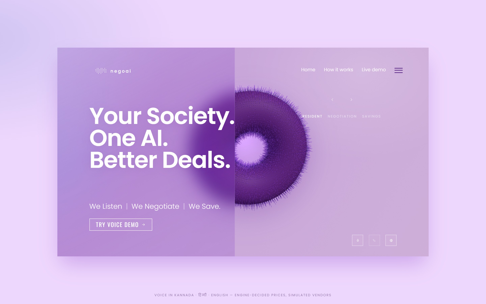
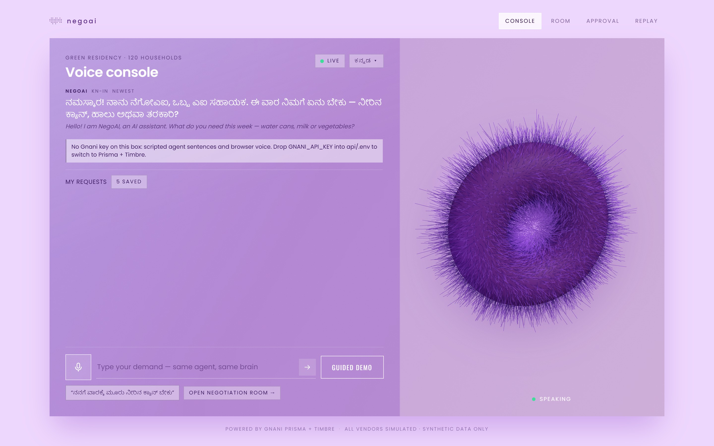
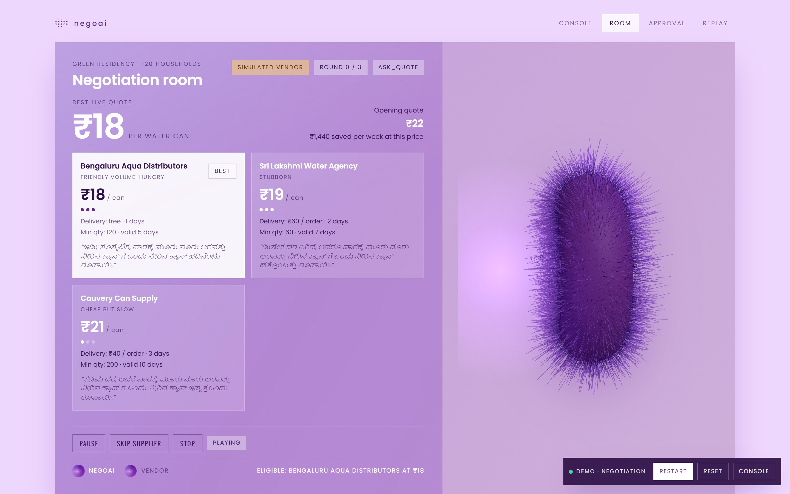
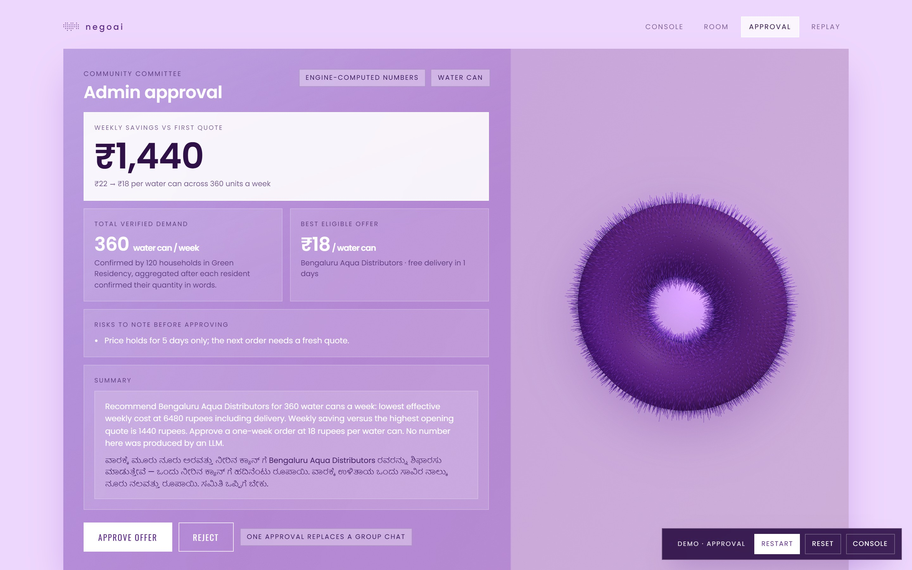
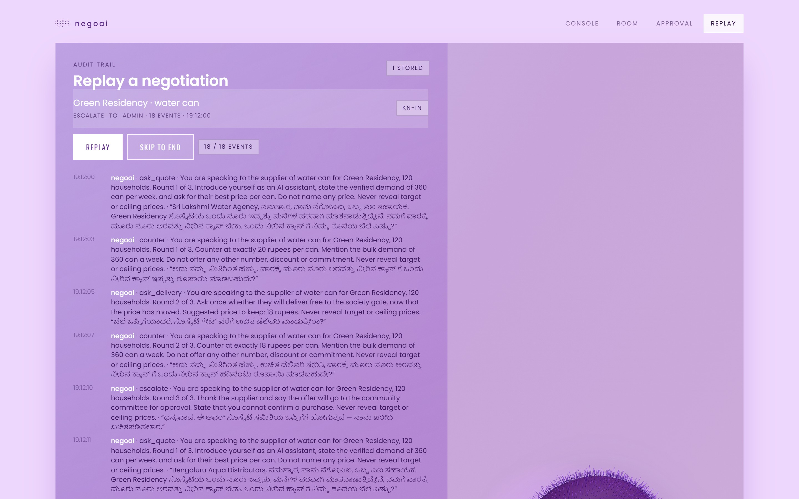
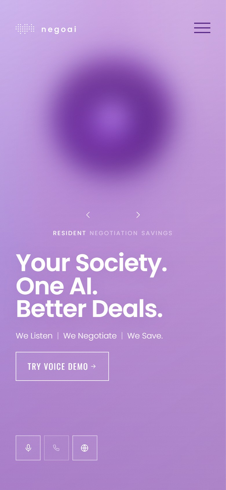
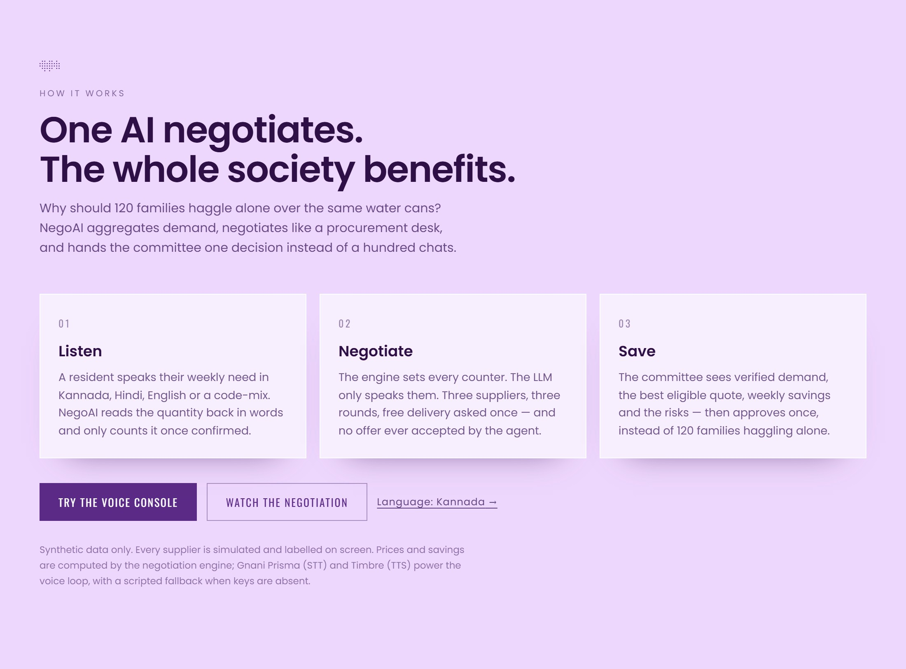
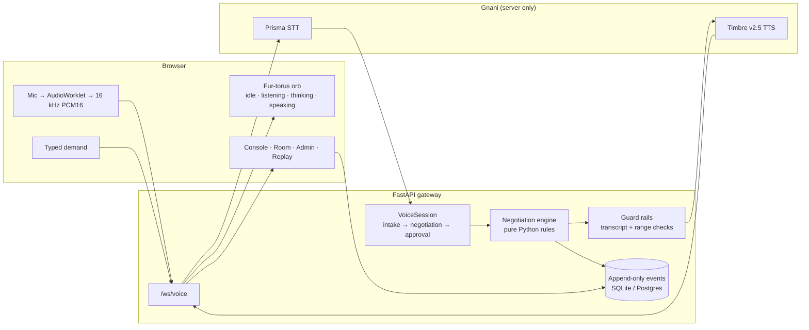

<p align="center">
  
</p>

<h1 align="center">NegoAI</h1>

<p align="center">
  <strong>Your society. One AI. Better deals.</strong><br />
  A multilingual voice negotiator that turns 120 separate requests into one committee-ready purchase.
</p>

<p align="center">
  
  
  
  
  
</p>

<p align="center">
  <a href="#quick-start"><strong>Run it</strong></a> ·
  <a href="#the-negotiation-engine"><strong>How the engine works</strong></a> ·
  <a href="docs/submission.md"><strong>Submission pack</strong></a> ·
  <a href="docs/qa.md"><strong>QA results</strong></a>
</p>

---

## The problem

Every family in an apartment building buys the same water cans, milk and vegetables — separately. Each one calls a different supplier. Nobody has volume, so nobody has leverage, and the committee ends up mediating a hundred scattered WhatsApp threads.

NegoAI gives the building one procurement desk. A resident speaks naturally in Kannada, Hindi, English or a code-mix. NegoAI confirms the quantity, aggregates the building's demand, negotiates with suppliers, and hands the committee a single decision with the savings and the risks already computed.

> **Why should 120 families haggle alone?**

## See it

### 1. Speak — the voice console



The resident's words appear as a live transcript with an English gloss. The orb stands up when it listens, pulses when it speaks, and spins when it thinks. Quantities are read back in words and only count after confirmation.

### 2. Negotiate — the room



Three simulated suppliers bid on the same verified demand. Every counter-price comes from the engine, the ticker animates downward, and the **Simulated vendor** badge never leaves the screen.

### 3. Approve — the committee



The committee sees the verified demand, best eligible offer, weekly savings and risks. The agent cannot accept an offer — only the committee can approve or reject.

### 4. Audit — replay



Every offer, directive and decision is an append-only event row, so the whole negotiation replays exactly — no re-simulation, no made-up history. The same screen shows the session's tamper-evident SHA-256 receipt, so a committee can keep the proof next to the decision.

### On a phone

<p align="center">
  
</p>

The landing page and app use container queries, so the hero, glass panels and orb stay proportional from a laptop to a 390 px Android phone.

## How it works



1. **Listen.** A resident speaks a weekly need. Intake asks one question at a time, reads numbers back in words, and re-asks if a number was not clearly heard.
2. **Aggregate.** Confirmed requests are summed into a verified community demand — 120 households × 3 cans = **360 water cans a week**.
3. **Negotiate.** The engine runs a three-round haggle against three simulated personas. It asks for free delivery once, cites a competing quote only when that quote exists in stored offers, and never accepts.
4. **Approve.** The best eligible offer is escalated with savings and risks. One decision replaces the group chat.
5. **Replay.** Every turn is a row in `negotiation_events`. The dashboard is just a view over that log.

## The negotiation engine

This is the part that makes NegoAI a negotiator and not a chatbot.

```text
states:  ASK_QUOTE → COUNTER_1 → COUNTER_2 → FINAL → ESCALATE_TO_ADMIN | WALK_AWAY

counter_k = quote − (quote − target) × [0.6, 0.8, 1.0][k−1]
```

- Counters are clamped at the target price, clamped at the live quote, and rounded to the rupee.
- An offer at or below the maximum price is marked **eligible** — never accepted.
- `try_accept()` always returns `False`, and tests prove it.
- Delivery is asked exactly once, after the price has moved.
- A competing quote can be mentioned once, and only if it exists in another vendor's recorded offers.
- A new offer clears queued directives, so the agent can never counter a stale price.

**The engine decides. The LLM speaks.** When an optional LLM is configured it may rephrase a turn, but any number it emits that is not in the engine directive or the transcript is rejected. Without a key, a deterministic composer writes the same lines. Model name and temperature live in `api/config.py`.

## Architecture



One brain, many channels: the browser mic, typed text and the guided demo all reach the same `VoiceSession` over one WebSocket. Vendor floors, target prices and committee ceilings never cross the wire.

### Voice pipeline

| Piece | Implementation |
| --- | --- |
| Capture | `getUserMedia` → AudioWorklet → linear resample to 16 kHz mono PCM16 |
| Speech in | Gnani Prisma v3.0 realtime STT over `wss://api.vachana.ai/stt/v3/stream`; language, model, VAD and domain keyterms travel as handshake headers |
| Speech out | Gnani Timbre v3.0 over `POST /api/v1/tts/inference` with `container: raw`, returned as 16 kHz PCM16 |
| Fallback | Prisma reconnects with backoff after a dropped stream; browser `SpeechRecognition` temporarily takes over when available; `SpeechSynthesis` and the scripted composer work without a key |
| Numbers | Digits and rupee signs are spelled out in the active language before TTS |
| Barge-in | Speaking while the agent talks stops playback and returns to listening |
| Credit guard | Per-session and global TTS character caps; falls back to text with a notice |

### Gnani models used

| Capability | Model / endpoint | Where |
| --- | --- | --- |
| Speech to text | Prisma v3.0 (`prisma-v3.0`), `wss://api.vachana.ai/stt/v3/stream` | `api/speech/gnani.py` |
| Text to speech | Timbre v3.0 (`timbre-v3.0`), `POST /api/v1/tts/inference`, raw PCM out | `api/speech/gnani.py` |
| Voice catalog | one agent voice + three distinct vendor voices, all three languages | `config/voices.json` |
| Domain tuning | `topic` + `keyterms` + VAD headers at handshake | `api/config.py`, `api/speech/gnani.py` |
| Auth | `X-API-Key-ID`, server only | `api/config.py` |

The key is read from `GNANI_API_KEY` / `GNANI_KEY_ID` on the server and is never sent to the browser or logged. `api/.env` is gitignored and loaded automatically at startup.

## Safety properties

- **The agent never accepts.** Only `POST /api/approvals` writes a decision, and the UI only offers eligible offers.
- **No invented numbers.** Engine directives carry every price; LLM output is checked against them and the transcript.
- **No secret leaves the server.** `/api/health` returns capabilities, never keys.
- **Vendors are labelled.** Every vendor row stores `source = simulated`; the badge appears on the room and admin screens.
- **AI disclosure first.** NegoAI introduces itself as an AI at the start of every negotiation.
- **Append-only audit.** A database trigger rejects updates and deletes on `negotiation_events`.
- **Tamper-evident receipt.** `GET /api/sessions/{id}/receipt` hashes every stored event into a SHA-256 chain. Edit or delete one row and the chain head the committee kept no longer matches.

## Tech stack

| Layer | Choice |
| --- | --- |
| Frontend | React 18, Vite 6, zustand, framer-motion, Three.js |
| Visuals | Container-query CSS, frosted glass, custom fur shader, Poppins + Oswald |
| Backend | FastAPI, Uvicorn, asyncio WebSockets |
| Voice | Gnani Prisma v3.0 (STT) + Timbre v3.0 (TTS), with browser fallback |
| Storage | SQLite locally; Supabase project wired (publishable + secret keys); Postgres schema/RLS/Realtime migration included |
| AI | Optional OpenAI-compatible LLM for rephrasing only |

## Quick start

**Prerequisites:** Python 3.11+, Node 18+, and (optionally) a Gnani API key.

```bash
# 1. API
python -m venv .venv
source .venv/bin/activate          # Windows: .venv\Scripts\activate
pip install -r api/requirements.txt
cp api/.env.example api/.env       # optional: add GNANI_API_KEY
uvicorn api.main:app --reload --port 8000

# 2. Web (new terminal)
cd web
npm install
npm run dev
```

Open **http://localhost:5173**. The API docs are at **http://localhost:8000/docs**.

The app runs with **zero keys**: the scripted composer and browser speech keep every flow working. Add a Gnani key to `api/.env` to switch STT and TTS to Prisma + Timbre.

Supabase is optional. Put the project's Postgres URI in `SUPABASE_DB_URL`, run `python scripts/apply_supabase.py`, and the schema, RLS, realtime publication and synthetic seed are applied and verified over PostgREST.

### Single-process mode

```bash
cd web && npm run build && cd ..
uvicorn api.main:app --port 8000
```

FastAPI serves the built SPA on the same origin, so `/ws/voice` needs no proxy.

### Guided demo

Open **`http://localhost:8000/?demo=1`** (or `/room?demo=1`) and press **Start demo**. The director walks the app through intake, negotiation and approval on its own, with a **Simulated vendor** badge and the required footer.

| Route | What it shows |
| --- | --- |
| `/` | Landing page with the live orb |
| `/console` | Voice console, transcript, confirm card, My requests |
| `/room` | Vendor cards, ticker, pause / skip / stop |
| `/admin` | Savings, risks, bilingual summary, approve / reject |
| `/replay` | Stored negotiation from the event log |
| `?demo=1` | Guided end-to-end run |

## Deploy on Vercel

The repo ships a Vercel-ready shape: `app.py` is the Python entrypoint, `vercel.json` installs the root `requirements.txt` and web dependencies, builds `web/dist`, includes that build in the Python function bundle, and Vercel routes the SPA, REST, and `/ws/voice` to one FastAPI function in the Mumbai region (`bom1`). WebSockets need Fluid Compute (on by default) and stay open until the function duration limit.

Set these in **Project Settings → Environment Variables**: `GNANI_API_KEY`, `GNANI_STT_MODEL`, `GNANI_TTS_MODEL`, and optionally `LLM_API_KEY` and the `SUPABASE_*` keys. Do **not** set `NEGOAI_DB`: Vercel's filesystem is read-only except `/tmp`, so the store automatically moves to `/tmp/negoai.sqlite3` there.

Known platform limits: a socket closes at the function duration (300 s on Hobby, configurable up to 800 s on Pro), and the `/tmp` SQLite file is per-instance and ephemeral — a replay request can land on another instance. Use Supabase for durable multi-instance state. The config and entrypoint are validated locally; the deploy itself was not run from this workspace.

```bash
npx vercel            # preview
npx vercel --prod     # production
```

## Project layout

```text
api/
  main.py                 FastAPI app, REST endpoints, SPA hosting
  db.py                   SQLite store, idempotent seed, aggregates
  receipt.py              SHA-256 chain over stored negotiation events
  config.py               env, voices.json, credit budget
  agents/
    intake.py             resident demand collector
    composer.py           localized agent and vendor lines
    guard.py              transcript/range validation
    llm.py                optional OpenAI-compatible client
    summary.py            admin summary from stored numbers
    prompts.py            runtime prompt templates
  negotiation/
    engine.py             deterministic state machine
    personas.py           three simulated suppliers with hidden floors
  speech/
    gnani.py              Prisma STT + Timbre TTS + credit guard
    numbers.py            number spelling and parsing (kn/hi/en)
  voice/
    gateway.py            /ws/voice protocol
    session.py            intake → negotiation → approval orchestration
  tests/                  47 pytest cases

web/
  src/
    components/           Hero, FurTorus, VoiceConsole, NegotiationRoom,
                          AdminApproval, Replay, DemoBar
    lib/                  WebSocket client, audio queue, worklet bridge
    state/                single event reducer
    styles/               glass, tokens, screens
  public/worklets/        PCM capture worklet

config/voices.json        language → Timbre voice
app.py                    Vercel Python entrypoint (re-exports api.main:app)
vercel.json               Vercel build, SPA and function duration
supabase/migrations/      schema, RLS, realtime, synthetic seed
scripts/                  smoke_test, run_negotiation, ws_client,
                          capture_screenshots, qa.md
docs/                     screenshots, QA log, submission pack
```

## Tests and scripts

```bash
python -m pytest api/tests -q          # 87 passed, no keys needed
python scripts/smoke_test.py           # live Timbre → Prisma roundtrip in kn/hi/en
python scripts/run_negotiation.py      # three personas, text mode, stores offers
python scripts/overlap_repro.py A B C  # serialized speech, gating, playback timing
python scripts/ws_client.py --mode guided
cd web && npm test                     # 9 frontend checks (node:test)
```

`run_negotiation.py` finishes in seconds and prints per-round prices. `ws_client.py` drives the real `/ws/voice` socket and prints the same events the browser receives.

**What is verified:** 87 Python tests plus 9 Node tests; engine math and guardrails, intake in three languages plus code-mixing, number spelling, composer output, PCM transport, LLM JSON extraction, SQLite persistence and idempotent seed, serialized speech and playback acknowledgements, half-duplex interruption and reconnect handling, the real `/ws/voice` protocol (guided run plus typed intake and language switch), API/health without secrets, demand aggregation **360 → 363**, the tamper-evident receipt chain, the production build, and a **live Gnani TTS → STT roundtrip in Kannada, Hindi and English** (`python scripts/smoke_test.py` prints PASS).

**What is not:** human-mic accuracy in a noisy room, interruption behaviour on a physical phone, and the Supabase schema deployment (the project is connected but its tables are not applied yet). These are recorded honestly in [`docs/qa.md`](docs/qa.md); [`scripts/qa.md`](scripts/qa.md) is the runbook for closing them.

## Languages

| Language | Text flows | Number words | Real Gnani voice |
| --- | --- | --- | --- |
| Kannada `kn-IN` | Tested | Tested | Verified (live roundtrip) |
| Hindi `hi-IN` | Tested | Tested | Verified (live roundtrip) |
| English `en-IN` | Tested | Tested | Verified (live roundtrip) |
| Code-mixed | Tested | — | — |

Language chips switch the agent, number words, TTS voice and confirm card together.

## Design language

The interface is built from the reference frame in the brief: a lavender canvas (`#EED7FD`), a frosted panel over a fuzzy purple torus, a white Poppins headline and an outlined Oswald CTA. Small text on glass uses `#3B1A5E` for phone legibility.

The orb is a real Three.js object: ~9,000 hair strands in one `LineSegments` buffer, a constant 15° tilt and a seamless 6.7 s 180° tumble. Its four states map to the conversation:

| State | Motion |
| --- | --- |
| `idle` | 6.7 s tumble, gentle sway |
| `listening` | turns face-on, fur stands up with mic level |
| `thinking` | 2.5× spin, tips lighten |
| `speaking` | fur pulses with TTS RMS |

A CSS conic-gradient fallback appears when WebGL is unavailable, and `prefers-reduced-motion` freezes the tumble.

## Limitations

- Suppliers are simulated personas with hidden floors. No real vendor is called.
- Water cans are the default product; milk and vegetables are configurable but less exercised.
- Local storage is SQLite. Supabase migrations are included and reviewed but not required for the demo.
- Telephony is out of scope: the phone button is disabled with a "coming soon" tooltip.
- Voice accuracy is verified with synthesized Timbre audio fed back through Prisma, not a human microphone; real-room noise is still untested.
- Multi-item utterances ("three cans and two litres of milk") are not yet collected in one turn.
- No payments, contracts, delivery tracking or real signup. `/api/demo-login` issues demo roles only.

## LLM disclosure

An LLM is optional and disabled unless `LLM_API_KEY` is set. It may only rephrase an engine directive; numbers are always engine-owned, and output containing an unsupplied number is discarded. With no key, the deterministic composer produces the same dialogue. The configured model name is exposed through server config so the README and submission can disclose it.

## Built for the challenge

Solo entry for the **Gnani.ai Great Indian AI Internship Challenge** (deadline 10 Nov 2026). Synthetic data only; every vendor is labelled simulated.

- [Submission pack](docs/submission.md) — 120-word explanation, post variants, 60-second shot list, pre-submit checklist
- [QA runbook](scripts/qa.md) and [results](docs/qa.md)
- [Architecture notes](ARCHITECTURE.md) — layer responsibilities and protocol details

### Regenerating the screenshots

The images above are captures of the running app, not mockups:

```bash
cd web && npm install --no-save playwright-core && cd ..
uvicorn api.main:app --port 8000          # another terminal
node scripts/capture_screenshots.mjs
```

<p align="center">
  <sub>Built with Gnani Prisma + Timbre · All vendors simulated · Synthetic data only</sub>
</p>
