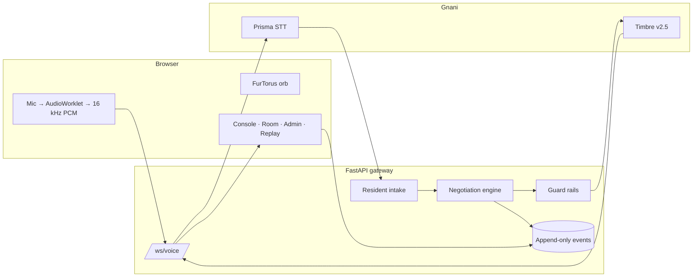

# NegoAI

<p align="center">
  
  
  
</p>

<p align="center">
  <strong>Your society. One AI. Better deals.</strong>
</p>

NegoAI is a voice-first negotiation assistant for apartment communities. Residents speak their requirements in Kannada, Hindi, English, or a code-mixed blend, and the system converts that messy input into one clean, committee-ready purchasing decision.

Built for real-world bulk buying friction: fewer chats, fewer calls, fewer duplicated negotiations, and one clear answer.

---

## ⚡ Why this exists

Housing societies buy the same essentials over and over:

- water cans
- housekeeping items
- maintenance materials
- bulk recurring supplies

But each resident negotiates separately. Each supplier is contacted in isolation. The final decision gets scattered across messages and calls.

NegoAI centralizes that workflow into one smart negotiation loop.

---

## 🚀 What it does

- captures resident demand in natural language
- understands mixed-language inputs
- confirms quantity before negotiation
- negotiates with simulated supplier personas
- calculates best eligible offer and weekly savings
- lets admins approve or reject with one click
- replays the full negotiation from stored events

This is not just a chatbot. It is a negotiation engine with guardrails.

---

## 🧠 The core idea

> The engine decides. The LLM speaks.

The negotiation engine owns pricing and quantity logic. The AI layer can rephrase or summarize, but it cannot invent numbers. If a model output introduces a price or quantity the engine never approved, it is rejected.

That keeps the system auditable, safe, and deterministic.

---

## 🎯 The experience

The app flows like this:

1. Resident describes the requirement
2. Quantity is confirmed
3. Negotiation room opens with supplier offers
4. Best offer is surfaced with savings
5. Committee approves or rejects
6. Full interaction is replayed from events

It feels like an AI procurement cockpit, but it is grounded in real negotiation rules.

---

## 🧩 Live flow

```text
Resident request
      ↓
Intake + confirmation
      ↓
Supplier negotiation room
      ↓
Best offer + savings
      ↓
Admin approval
      ↓
Replay / audit trail
```

---

## 🛠️ Tech stack

- Frontend: React + Vite + JavaScript
- Visuals and motion: framer-motion, Three.js, CSS
- Backend: FastAPI + Uvicorn
- Storage: SQLite with append-only event logs
- Real-time layer: WebSocket gateway
- Optional AI: LLM rephrasing + Gnani voice services

---

## 📁 Project structure

```text
api/
  main.py                  FastAPI app and SPA hosting
  db.py                    SQLite store and seeded data
  config.py                config and voice settings
  agents/
    intake.py              resident intake flow
    composer.py            directive-to-speech generation
    guard.py               validates LLM output against engine decisions
    prompts.py             runtime prompts
    llm.py                 optional LLM integration
    summary.py             summary logic
  negotiation/
    engine.py              negotiation state machine and pricing logic
    personas.py            simulated supplier personas
  speech/
    gnani.py               STT/TTS integrations
    numbers.py             multilingual number parsing
  voice/
    gateway.py             websocket communication layer
    session.py             orchestration: intake -> negotiation -> approval
  tests/
    ...                    negotiation, guardrail, API, demo tests

web/
  src/
    components/
      Hero.jsx
      VoiceConsole.jsx
      NegotiationRoom.jsx
      AdminApproval.jsx
      Replay.jsx
    pages/
    state/
  public/
    worklets/
      pcm-worklet.js

supabase/
  migrations/
    0001_init.sql
    seed.sql

scripts/
  smoke_test.py
```

---

## 🚀 Quick start

### Backend

```bash
python -m venv .venv
.venv/Scripts/python.exe -m pip install -r api/requirements.txt
.venv/Scripts/python.exe -m uvicorn api.main:app --reload --host 0.0.0.0 --port 8000
```

### Frontend

```bash
cd web
npm install
npm run dev -- --host 0.0.0.0
```

Then open:

- http://localhost:5173
- http://localhost:8000/docs

### Single-process mode

```bash
cd web
npm run build
cd ..
.venv/Scripts/python.exe -m uvicorn api.main:app --host 0.0.0.0 --port 8000
```

---

## 🎤 Multilingual voice support

The project supports:

- Kannada
- Hindi
- English
- mixed-language requests

By default it falls back to browser speech recognition and synthesis. Optional Gnani integrations can be plugged in with credentials.

---

## ✅ Testing

```bash
.venv/Scripts/python.exe -m pytest api/tests -q
python scripts/run_negotiation.py
python scripts/ws_client.py --mode guided
```

The suite covers:

- pricing logic
- negotiation guardrails
- language parsing
- admin decision flow
- end-to-end demo behavior

---

## 💡 Why it matters

This project turns a messy real-world process into a clean, explainable AI workflow:

- fewer manual back-and-forth conversations
- less negotiation friction
- more transparent pricing decisions
- one final answer for the committee

That is the real value of NegoAI.

---

## 🔎 Important note

- supplier behavior is simulated, not live
- SQLite is used for local development
- voice quality depends on browser/system support
- external AI or voice services are optional for the demo flow

---

## 🏗️ Architecture



One brain, many channels. The browser mic, typed text and the guided demo all
reach the same `VoiceSession` over one WebSocket. Vendor floors, target prices
and committee ceilings never cross the wire.

## 🎙️ Gnani models used

| Capability | Model / endpoint | Where |
| --- | --- | --- |
| Speech to text | Prisma realtime, `wss://api.vachana.ai/stt/v3/stream` | `api/speech/gnani.py` |
| Text to speech | Timbre v2.5 (`timbre-v2.5`), `POST /api/v1/tts/inference` | `api/speech/gnani.py` |
| Voice catalog | language → voice names in `config/voices.json` | `api/config.py` |
| Auth | `X-API-Key-ID`, server only | `api/config.py` |

The Gnani key is read from `GNANI_API_KEY`/`GNANI_KEY_ID` on the server and is
never sent to the browser. Without a key the app still runs with the scripted
composer and browser speech.

## 🌐 Languages actually tested

The deterministic text flows, number spelling and parsing are tested in
**Kannada, Hindi and English**, including code-mixed input. Real Prisma/Timbre
voice calls were **not** exercised in this workspace because no challenge key
was present; `scripts/smoke_test.py` is the first check to run when it is. The
language chips expose the three languages above.

## 👥 Team contribution

Solo build. Design and UI, voice gateway, resident intake, negotiation engine,
personas, persistence, screens and tests were all written for this entry.

## ⚠️ Limitations

- Vendors are simulated personas with hidden floors; no real supplier is called.
- Water cans are the default product; milk and vegetables are configurable but
  less exercised.
- Local storage is SQLite; the Supabase migrations exist but are not required
  for the demo.
- Telephony is out of MVP scope: the phone button is disabled.
- The Gnani STT/TTS payloads follow the blueprint's documented endpoints but
  must be confirmed against the challenge account.
- No payments, contracts, delivery tracking or real signup.

## 🤖 LLM disclosure

An LLM is optional (`LLM_PROVIDER`-style OpenAI-compatible endpoint). When
configured it may only *rephrase* a turn; every number comes from the engine,
and any price in its output that is not in the engine directive or the
transcript is rejected. With no LLM key, a deterministic composer writes the
same lines. Model name and temperature live in `api/config.py`.

Submission material: `docs/submission.md`, QA runbook in `scripts/qa.md`, results
in `docs/qa.md`.

## 🏁 Built for the challenge

This project was created as a prototype for the Gnani.ai challenge, centered on the idea of an AI-powered community procurement assistant that is multilingual, auditable, and human-friendly.

---

## 📌 Summary

NegoAI is a voice-driven negotiation system that turns noisy human input into a clean, defensible purchasing decision. It feels modern and interactive, but underneath it is grounded in deterministic pricing logic, explicit safeguards, and clear business value.

---

<details>
  <summary><strong>Quick demo routes</strong></summary>

- `/` — landing experience
- `/console` — live transcript and voice console
- `/room` — negotiation room
- `/admin` — approval view
- `/replay` — event playback
- `?demo=1` — guided demo mode

</details>
